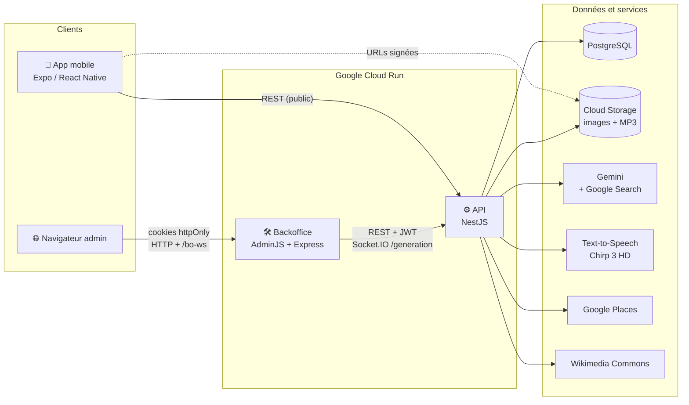
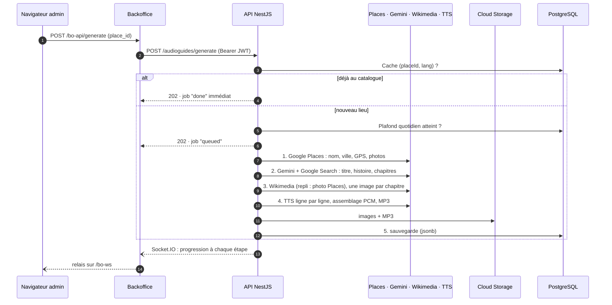
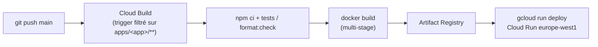

<div align="center">

# 🎧 Muséo

**Des audioguides pour enfants, générés par IA pour n'importe quel lieu.**

Choisis un musée, une abbaye ou un monument : Muséo écrit une visite adaptée aux 6-12 ans, l'illustre, l'enregistre avec une voix naturelle et l'affiche en karaoké synchronisé sur mobile.


</div>

---

## Sommaire

- [En bref](#en-bref)
- [Fonctionnalités](#fonctionnalités)
- [Architecture](#architecture)
- [Le pipeline de génération](#le-pipeline-de-génération)
- [Zoom sur les apps](#zoom-sur-les-apps)
  - [📱 Mobile — Expo / React Native](#-mobile--expo--react-native)
  - [⚙️ API — NestJS](#️-api--nestjs)
  - [🛠️ Backoffice — AdminJS](#️-backoffice--adminjs)
- [Sécurité](#sécurité)
- [Infra et déploiement](#infra-et-déploiement)
- [Choix techniques et compromis](#choix-techniques-et-compromis)
- [Démarrer en local](#démarrer-en-local)

---

## En bref

| | |
|---|---|
| **Produit** | App mobile de visite audio pour enfants, avec un catalogue de lieux partagé entre tous les utilisateurs |
| **IA** | Gemini (texte, avec *grounding* Google Search), Google Cloud Text-to-Speech (voix Chirp 3 HD) |
| **Données** | Google Places (lieu, coordonnées, photos) et Wikimedia Commons (illustrations) |
| **Stack** | Expo · React Native · NestJS · TypeORM · PostgreSQL · AdminJS · Socket.IO |
| **Infra** | Google Cloud Run, Cloud Storage, Secret Manager, Cloud Build |
| **Repo** | Monorepo Nx avec 3 apps TypeScript |

---

## Fonctionnalités

### Pour les visiteurs (app mobile)
- 🗺️ **Carte interactive** des audioguides disponibles. La caméra cadre automatiquement tous les lieux, reste dans une zone définie et affiche la position de l'utilisateur.
- 🎧 **Lecteur audio par chapitre** : lecture, pause, avance et retour rapides, navigation entre chapitres.
- 🎤 **Transcript karaoké** : la ligne lue est surlignée en temps réel, et un tap sur une ligne y déplace la lecture.
- 🖼️ **Une illustration par chapitre** et une photo principale du lieu.
- 🕘 **Historique** des 10 derniers lieux visités, stocké sur l'appareil.
- 📶 **Cache hors ligne** du catalogue : les requêtes sont persistées sur l'appareil pendant 24 h.
- 🌗 Thème clair / sombre.
- 🔓 **Aucun compte nécessaire** : le catalogue se consulte sans authentification.

### Pour les administrateurs (backoffice web)
- 🔎 **Génération d'un audioguide** à partir d'une recherche Google Places avec autocomplétion. Si le lieu est déjà au catalogue, le backoffice le signale.
- 📊 **Progression en direct** de chaque génération par websocket : lecture du lieu, écriture, images, enregistrement, sauvegarde.
- ✏️ **Édition du contenu** avec un éditeur structuré des chapitres ou en JSON brut.
- ▶️ **Écoute et prévisualisation** des médias de chaque chapitre.
- 👥 **Gestion des comptes** et des rôles.
- 📈 **Dashboard** : total des audioguides, générations du jour face au plafond quotidien, répartition par langue.

---

## Architecture



**Principe central : l'API est la seule à accéder aux données.** Le backoffice n'a ni connexion à la base, ni credentials Google Cloud, ni table d'utilisateurs. Il passe entièrement par l'API. Le mobile ne voit jamais de chemin de stockage : il reçoit des **URLs signées** valables une heure.

### Structure du monorepo

```
.
├── apps/
│   ├── mobile/        # Expo SDK 57 · React 19 · expo-router · NativeWind · Gluestack UI
│   ├── api/           # NestJS 11 · TypeORM · PostgreSQL · Socket.IO · Swagger
│   └── backoffice/    # AdminJS 7 · Express 4 · React 18
├── nx.json            # cache et orchestration des tâches
└── package.json       # scripts racine
```

Chaque app garde son propre `package.json` et son propre lockfile, sans npm workspaces. Ce n'est pas un oubli : les apps ont des contraintes de versions incompatibles, par exemple React 19 pour Expo contre React 18 pour AdminJS. Nx orchestre les scripts de chaque app, met les builds en cache et déclare les dépendances entre projets : le backoffice dépend de l'API, dont il génère les types depuis la spec OpenAPI.

---

## Le pipeline de génération

Générer un audioguide enchaîne cinq services externes et dure couramment plus d'une minute, plus longtemps qu'une requête HTTP ne peut raisonnablement attendre. La génération est donc **asynchrone** : l'API répond `202 Accepted` avec un identifiant de job, puis pousse la progression par websocket.



### Les étapes en détail

1. **Google Places** : nom, ville (extraite des composants d'adresse), coordonnées, note et références photo. La photo principale est téléchargée puis envoyée sur Cloud Storage.
2. **Gemini avec *grounding* Google Search** : le modèle produit un JSON strict avec un titre, une introduction historique et 4 à 10 chapitres. Le prompt est travaillé en détail :
   - le nombre de chapitres dépend de la taille du lieu ;
   - les titres génériques (« l'aventure de… ») sont interdits ;
   - le ton s'adapte au lieu (sobriété pour un lieu de mémoire, émerveillement pour un palais) ;
   - chaque chapitre vise 280 à 700 mots, soit 2 à 5 minutes d'écoute ;
   - le texte est **déjà découpé en lignes** pour l'affichage karaoké.
   La réponse est validée avant utilisation, et les erreurs de surcharge sont relancées avec un *backoff* exponentiel.
3. **Illustrations** : une recherche Wikimedia Commons par chapitre, avec une requête courte générée par le LLM. Si rien n'est trouvé, une photo Google Places du lieu sert de repli, pour que chaque chapitre ait une image. Les appels sont séquentiels, car Wikimedia répond 429 en parallèle, et le type MIME de chaque réponse est vérifié pour ne pas stocker une page d'erreur HTML comme photo.
4. **Synthèse vocale et synchronisation karaoké** : c'est le point le plus technique, détaillé juste après.
5. **Persistance** : une ligne en base par couple `(placeId, lang)`, avec un index unique. Le contenu est stocké en `jsonb` et référence les **chemins** Cloud Storage, jamais les URLs.

### Synchronisation karaoké sans SSML

Les voix Chirp 3 HD sonnent très naturellement, mais elles ne gèrent pas les balises SSML `<mark>`. Impossible donc d'obtenir de la synthèse vocale le moment où commence chaque ligne. La solution :

- **chaque ligne est synthétisée séparément** en PCM 16 bits (LINEAR16, 24 kHz) ;
- l'API **parse elle-même le WAV** (chunks RIFF), **concatène** les échantillons en insérant 350 ms de silence entre les lignes, et encode le résultat en **MP3** avec `lamejs` ;
- l'instant de début de chaque ligne est **calculé exactement à partir du nombre d'échantillons**, ce qui produit un transcript horodaté que le mobile affiche avec `react-native-transcript-karaoke`.

Une ligne correspond à une requête TTS, ce qui épuise vite le quota par minute. Un **limiteur de concurrence maison** plafonne à 4 le nombre de requêtes en vol pour tout le processus. Il est combiné à des *retries* avec *backoff*, ciblés sur les erreurs `RESOURCE_EXHAUSTED` et assez longs pour que la fenêtre de quota se renouvelle.

### Maîtrise des coûts

Chaque génération coûte des appels Gemini et TTS. Trois garde-fous :

| Garde-fou | Portée |
|---|---|
| Rôle `admin` obligatoire | Seuls les admins peuvent générer. Les autres consultent le catalogue. |
| *Rate limiting* (`@nestjs/throttler`) | 5 générations par heure et par compte, avec repli sur l'IP |
| Plafond quotidien global | 100 générations réussies par jour, tous comptes confondus. Au-delà, l'API renvoie 503. |
| Cache par `(placeId, lang)` | Un lieu déjà généré est renvoyé immédiatement, sans aucun appel facturé. |

---

## Zoom sur les apps

### 📱 Mobile — Expo / React Native

`apps/mobile` · Expo SDK 57 · React Native 0.86 · React 19 · TypeScript

| Sujet | Implémentation |
|---|---|
| Navigation | `expo-router` (routing par fichiers) |
| UI | **Gluestack UI v3** et **NativeWind v4** (Tailwind), avec un design system maison et des polices manuscrites |
| Données serveur | **TanStack Query**, persisté dans AsyncStorage (`staleTime` 5 min, `gcTime` 24 h) |
| Audio | `expo-audio` |
| Carte | `react-native-maps` (Apple Maps sur iOS, Google Maps sur Android), variante `.web.tsx` pour le web |
| Animations | Reanimated 4, Lottie |
| Tests | Jest et Testing Library |

**Points notables :**
- **Composants *smart / dumb*** : chaque écran (`HomeScreen`) gère la logique et le chargement des données, et délègue le rendu à une vue pure (`HomeScreenView`). Les vues sont faciles à tester et à faire évoluer.
- **Un seul lecteur actif à la fois** : un registre audio arrête le lecteur précédent quand un autre démarre. Les lecteurs sont créés à la demande, puis mis en pause et libérés au démontage pour que le son s'arrête immédiatement au changement de chapitre.
- **Carte avec limites de zone** : `react-native-maps` n'a pas d'option `maxBounds`. On laisse donc le geste se terminer, puis on ramène la caméra dans la zone si elle en est sortie, en conservant le ratio d'affichage. Un délai de 400 ms après chaque mouvement déclenché par le code évite la boucle infinie (`animateToRegion` relance `onRegionChangeComplete`) sans jamais bloquer un geste de l'utilisateur. La logique de calcul (`lib/mapBounds.ts`) est pure et couverte par des tests unitaires.
- **Sans compte** : l'app démarre directement sur la carte. Les écrans de login sont archivés dans `disabled-screens/` et exclus du typecheck, prêts à être réactivés.

### ⚙️ API — NestJS

`apps/api` · NestJS 11 · TypeORM · PostgreSQL · Socket.IO

```
src/
├── audioguide/
│   ├── audioguide.service.ts        # pipeline de génération
│   ├── audioguide.prompts.ts        # prompt Gemini
│   ├── audio.utils.ts               # parsing WAV, assemblage PCM, encodage MP3
│   ├── audioguide.utils.ts          # retry/backoff, limiteur, parsing, chemins GCS
│   ├── jobs/                        # registre des jobs et gateway websocket
│   ├── audioguide.controller.ts     # routes publiques et génération
│   └── admin-audioguide.controller.ts
├── auth/                            # JWT access/refresh, guards, rôles
├── users/                           # comptes et administration des rôles
└── common/                          # entité de base, intercepteurs, throttling
```

| Endpoint | Accès | Rôle |
|---|---|---|
| `GET /audioguides` | public | Catalogue paginé, filtrable par langue |
| `GET /audioguides/:id` | public | Audioguide complet avec URLs signées |
| `POST /audioguides/generate` | admin | Lance une génération et renvoie `202` avec le job |
| `GET /admin/audioguides` | admin | Liste filtrable et triable (lieu, ville, langue) |
| `PATCH / DELETE /admin/audioguides/:id` | admin | Édition et suppression |
| `GET /admin/audioguides/stats` | admin | Totaux, générations du jour, plafond, répartition par langue |
| `GET /admin/audioguides/jobs/:jobId` | admin | État d'un job, en repli du websocket |
| `POST /auth/login` · `refresh` · `logout`, `PATCH /auth/password` | — | Authentification JWT (inscription publique désactivée) |
| `GET / PATCH /admin/users` | admin | Comptes et changement de rôle |
| `WS /generation` | admin | Progression des jobs (Socket.IO) |

**Points notables :**
- **Validation stricte** des DTO (`whitelist` et `forbidNonWhitelisted`) : un champ inconnu est rejeté.
- **Stockage découplé des URLs** : la base ne contient que des chemins Cloud Storage, et les URLs sont signées au moment de la lecture. Les routes admin renvoient les chemins bruts, parce qu'écrire une URL signée dans la base casserait la lecture une fois la signature expirée.
- **Registre de jobs en mémoire**, sur la base d'un `EventEmitter` : les abonnements renvoient leur fonction de désabonnement pour éviter les fuites de listeners, et les jobs terminés sont supprimés après 30 minutes.
- **Swagger** n'est exposé qu'en développement. La spec OpenAPI sert à générer les types du backoffice.
- **Tests** : 11 fichiers de tests unitaires (Jest) et un test e2e. Ils conditionnent le déploiement en CI.

### 🛠️ Backoffice — AdminJS

`apps/backoffice` · AdminJS 7 · Express 4 · React 18

- **Ressource AdminJS adossée à une API REST** : AdminJS est normalement branché sur un ORM. Ici, une classe `ApiResource` maison (qui étend `BaseResource`) traduit ses appels `find`, `count`, `findOne`, `update` et `delete` en requêtes HTTP vers l'API.
- **Contexte de requête avec `AsyncLocalStorage`** : AdminJS ne transmet pas la requête Express à ses ressources. Les jetons de l'admin connecté sont donc portés par un `AsyncLocalStorage`, ce qui rattache chaque appel à l'API à l'admin qui l'a déclenché plutôt qu'à un compte de service partagé.
- **Relais websocket** : le navigateur ne possède aucun jeton de l'API, puisqu'ils vivent dans des cookies `httpOnly`. Il se connecte donc à `/bo-ws` sur le backoffice, qui ouvre la connexion Socket.IO vers l'API à sa place.
- **Types générés** depuis l'OpenAPI de l'API (`openapi-typescript`), complétés à la main pour la forme du `jsonb`.
- **Composants React maison** : éditeur de chapitres, lecteurs audio, page de génération avec autocomplétion Places, dashboard. Le tout avec un thème personnalisé et une interface en français.

---

## Sécurité

- **JWT access (15 min) et refresh (7 jours)**. Le refresh token est **stocké haché (bcrypt)** en base et invalidé au logout et au changement de mot de passe.
- **Autorisation par rôle** (`@Roles(UserRole.ADMIN)` + `RolesGuard`) sur la génération, les routes `/admin/*` et le websocket. Une connexion websocket non admin est coupée au niveau transport (`disconnect(true)`), pas seulement au niveau de la session Socket.IO.
- **Backoffice sans état** : les jetons sont dans des cookies `httpOnly`. À chaque requête, le backoffice **revérifie la signature** avec l'algorithme verrouillé sur HS256, puis vérifie le rôle, pour empêcher la falsification d'un jeton `role: admin`. Le renouvellement du jeton est transparent. Une liste d'emails autorisés peut restreindre l'accès en plus du rôle.
- **Rien de sensible dans le HTML** : l'objet `currentAdmin` que AdminJS sérialise côté client ne contient que l'identité, jamais les jetons.
- **Aucune clé côté client** : Google Places est appelé via un proxy du backoffice, et les secrets vivent dans Secret Manager.
- **Médias privés** : le bucket Cloud Storage n'est pas public, les médias ne sont accessibles que par URL signée.

---

## Infra et déploiement



- **Un pipeline par service**, déclenché uniquement quand un fichier de ce service change.
- **Images Docker multi-stage** : l'image finale ne contient que `dist/` et les dépendances de production, et tourne en `USER node`.
- **Tests bloquants** : si les tests de l'API ou le contrôle de formatage du backoffice échouent, il n'y a pas de déploiement.
- **Cloud Run** :
  - l'API tourne avec `--no-cpu-throttling`, sinon l'instance serait gelée dès l'envoi de la réponse `202` et la génération s'arrêterait en plein milieu ;
  - chaque service utilise un **service account dédié** ;
  - les secrets sont injectés depuis **Secret Manager**.

---

## Choix techniques et compromis

| Choix | Pourquoi | Contrepartie assumée |
|---|---|---|
| Génération asynchrone (202 + websocket) | Le pipeline dépasse le temps qu'une requête HTTP peut tenir | Il faut un canal temps réel et une route de repli |
| Jobs en mémoire | Un job n'a de sens que pendant qu'on le suit, et un redémarrage ne perd rien que la base n'ait déjà | Sur plusieurs instances, il faut l'affinité de session |
| TTS ligne par ligne | Seule façon d'avoir un karaoké exact avec des voix Chirp, sans SSML | Plus de requêtes, d'où le limiteur et les *retries* |
| Chemins GCS en base, URLs signées à la lecture | Médias privés, pas d'URL expirée stockée en base | Une signature par média à chaque lecture |
| Monorepo Nx sans workspaces | React 18 et React 19 incompatibles, Dockerfiles autonomes | Une installation de dépendances par app |
| Backoffice sans base de données | Une seule source de vérité, aucun credential à gérer | Tout passe par l'API, d'où un aller-retour réseau par action |

---

## Démarrer en local

**Prérequis** : Node 22+, PostgreSQL, un projet Google Cloud (Places, Gemini, Text-to-Speech, Cloud Storage).

```bash
npm install            # Nx à la racine
npm run install:all    # dépendances de chaque app
```

Copie `apps/api/.env.sample` et `apps/backoffice/.env.sample` en `.env`, puis renseigne les variables.

```bash
npm run mobile       # Expo (aussi : npm run ios | android | web)
npm run api          # API en watch (Swagger sur http://localhost:3000/api)
npm run backoffice   # backoffice sur http://localhost:4000/admin
npm run dev          # API + backoffice en parallèle
npm run build        # build de toutes les apps (avec cache Nx)
npm test             # tests unitaires
npm run graph        # graphe des dépendances entre projets
```

Pour créer un compte admin : [`apps/api/docs/comptes-admin.md`](apps/api/docs/comptes-admin.md).

---

<div align="center">

Conçu et développé par **Noé Gambini**

</div>
